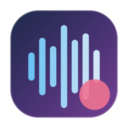
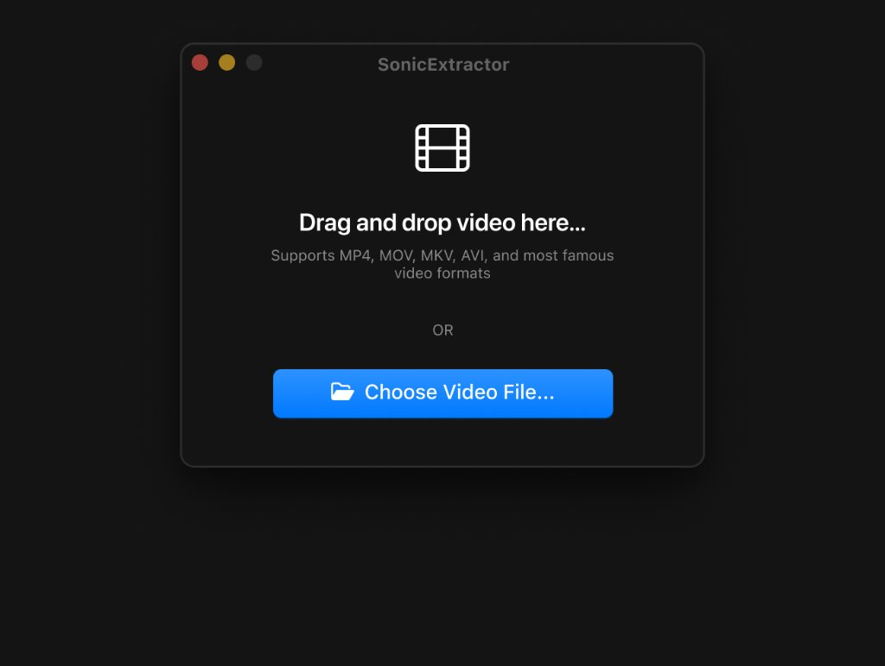
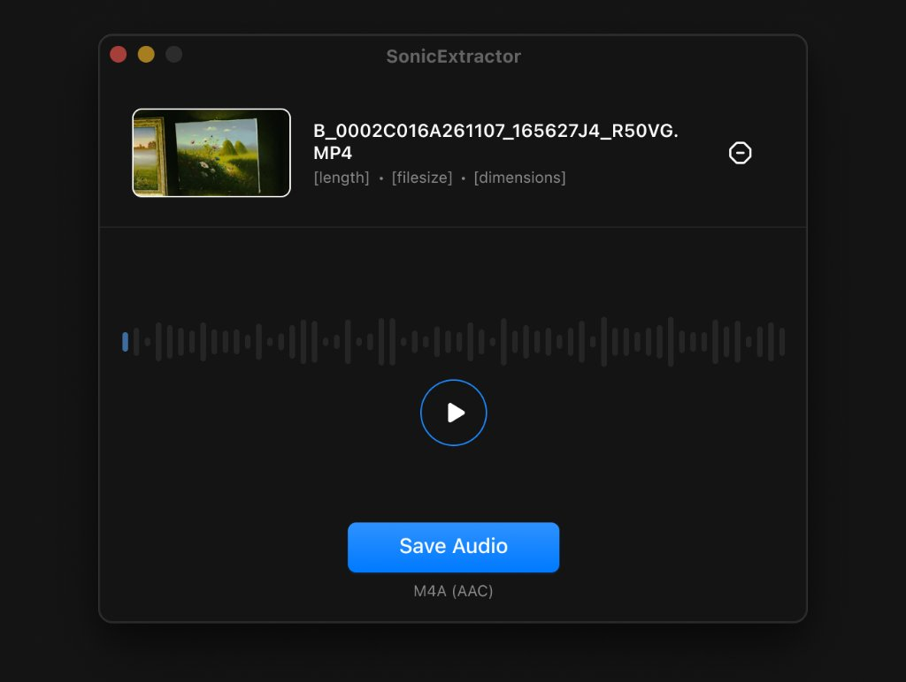

  
  <h1>SonicExtractor</h1>
  
<strong>A sleek, high-fidelity macOS desktop utility to extract audio tracks from any video.</strong>

  

    
    
    
    
  

  

    
  

 

---

## ✨ Features

- **⚡️ Zero-Friction Workflow**: Drag and drop any video file onto the canvas, or select via the native macOS file picker.
- **🎬 Wide Format Support**: Compatible with MP4, MOV, MKV, AVI, WebM, and all common video containers.
- **🌊 Interactive Waveform & Scrubbing**: Live audio waveform visualization with scrubbing and instant playback transport ring.
- **🎵 High-Fidelity Audio**: Direct, lossless extraction to standard `M4A (AAC)` format powered natively by Apple's AVFoundation engine.
- **🎯 16:9 Unletterboxed Thumbnail**: Automatically detects and crops camera container borders (e.g., Canon EOS EXIF letterboxing) so video previews maintain exact 16:9 proportions.
- **✨ Tactile Acoustic Feedback**: Custom acoustic cues for video load, close/dismiss, and export success.
- **🪄 Seamless Window Transitions**: Fluid top-anchored window expansion between the compact drop zone and the expanded audio studio.

---

## 📸 Screenshots

  <h3>Stage 1 — Minimalist Drop Zone</h3>
  

    

  <h3>Stage 2 — Expanded Audio Studio</h3>
  

---

## 📦 Installation

1. Download the latest **[SonicExtractor.dmg](https://github.com/visualbyte/sonic-extractor/releases/latest/download/SonicExtractor.dmg)**.
2. Open the disk image and drag **AudioExtractor** into your **Applications** folder.
3. **First-Time Launch (macOS Gatekeeper)**:
   - Right-click (or Control-click) `AudioExtractor` in your Applications folder and select **Open**.
   - Click **Open** in the confirmation dialog.

---

## 💻 System Requirements

- **Operating System**: macOS 14.0 (Sonoma) or macOS 15.0 (Sequoia) and later.
- **Hardware**: Apple Silicon (M1/M2/M3/M4) or Intel Mac.

---

  
Crafted with precision for macOS by <a href="https://github.com/visualbyte">Vishal Gupta</a>.

